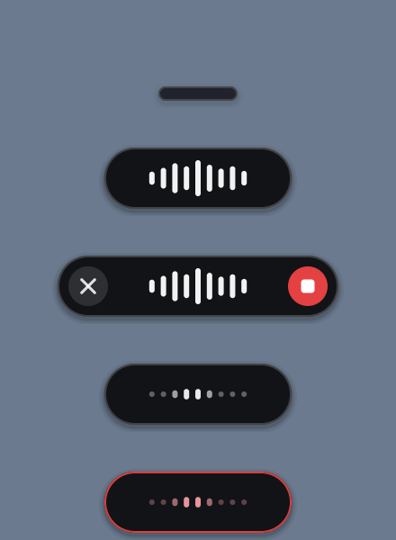

<div align="center">


# OpenFlow

**Free, local, private voice dictation. Double-tap Caps Lock, talk, and clean text appears wherever you're typing.**

[](https://github.com/Vivek-C-Shah/openflow/actions/workflows/ci.yml)
[](LICENSE)
%20%7C%20Linux%20(beta)-555)


</div>

OpenFlow is an open-source alternative to paid dictation apps. It runs entirely on your own computer, costs nothing, sends nothing anywhere, and stays out of the way until you need it.

## Why OpenFlow

- **Uses almost nothing until you need it.** When idle, OpenFlow is a keyboard hook and a tiny static bar: **~2.4 MB of RAM and 0% CPU**. The microphone is off and no AI model is loaded.
- **Fast.** The speech and AI engines start the instant you trigger dictation and warm up *while you're talking*. On a mid-range laptop GPU (RTX 3050), text appears **~0.85 s after you stop speaking**, including the first dictation after idle. The engines unload 30 s after you finish, freeing all of their memory.
- **Smart.** It removes "um", "uh" and stutters, applies self-corrections ("Tuesday, no wait, Wednesday" → "Wednesday"), fixes misheard words from context, adds punctuation, turns spoken lists into real lists, and matches the tone of the app you're in (relaxed in WhatsApp and Slack, proper in email, literal in VS Code and terminals). It also uses your personal dictionary and snippets, and handles **English and Hinglish**.
- **Hard to break.** If the AI's output drifts from what you said (an answer, an addition, a deletion), a guard rejects it and uses safe rule-based cleanup instead. If local AI fails, the cloud takes over, and vice versa. Silence never types phantom "Thank you." text. Your clipboard is restored after pasting. Every dictation is saved locally, so nothing you say is ever lost.
- **Free forever.** It's built on [whisper.cpp](https://github.com/ggml-org/whisper.cpp), [llama.cpp](https://github.com/ggml-org/llama.cpp) and open-weight models. You can optionally add a free [Groq](https://console.groq.com/keys) key for a smarter cloud AI and an automatic backup.

## Install

**Windows** (PowerShell):

```powershell
irm https://raw.githubusercontent.com/Vivek-C-Shah/openflow/main/install.ps1 | iex
```

**macOS / Linux** (beta, see [platform status](#platform-status)):

```sh
curl -fsSL https://raw.githubusercontent.com/Vivek-C-Shah/openflow/main/install.sh | sh
```

The installer checks your hardware, downloads the right engines and models once, turns on start-at-login, and starts OpenFlow. After that it works fully offline.

| Your hardware | Speech model | AI model | Download |
|---|---|---|---|
| NVIDIA GPU / Apple Silicon | Whisper large-v3-turbo (q5) | Qwen2.5 3B Instruct | ~3.2 GB (+ ~2 GB CUDA runtime on Windows) |
| CPU only | Whisper small (q5) | Qwen2.5 1.5B Instruct | ~1.3 GB |

Setup options: `--cpu`, `--gpu`, `--cloud` (no downloads; uses Groq), `--no-autostart`.

## Use

| Do this | What happens |
|---|---|
| **Double-tap** Caps Lock | Hands-free dictation starts and the pill expands with live voice bars |
| **Tap** Caps Lock (or click ■) | Finish: your text is pasted |
| **Hold** Caps Lock | Push-to-talk: release to finish |
| **Esc** (or click ✕) | Cancel |

Your Caps Lock state is always restored, and a normal single press still works as Caps Lock.



The tray icon menu has: copy last dictation, history, settings, start at login, show the idle bar, logs, and quit.

### Command line

```
openflow status | start | stop | restart
openflow config            # open settings; then: openflow reload
openflow test 5            # record 5 s and show what would be typed (nothing is pasted)
openflow last              # copy your last dictation again
openflow history           # what you said vs. what was typed
openflow doctor            # check the installation
openflow autostart on|off
```

## Configure

Run `openflow config` to open a fully commented settings file. The most useful settings:

```toml
[trigger]
key = "CapsLock"             # RightAlt, RightCtrl, F13...

[speech]
language = "auto"            # "en", "hi", ...
script = "latin"             # Hinglish in English letters; "native" keeps Devanagari
beam_size = 5                # 1 = fastest, 5 = most accurate

[engines]
idle_unload_seconds = 30     # 0 = free memory right after each dictation

[output]
overlay = true
idle_bar = true

[dictionary]
words = ["Kubernetes", "Supabase", "Priya"]

[snippets]
"my email" = "me@example.com"

[apps]
"notion" = "casual"          # force a style for an app or window title
```

## How it works

```
idle        openflow-daemon: keyboard hook + static idle bar   (~2.4 MB, 0% CPU)
               │ double-tap / hold
trigger     mic on · whisper-server + llama-server start and warm up while you talk
               │ tap / release
finish      16 kHz audio → speech check → Whisper (beam 5) → LLM cleanup
            → drift guard → snippets → paste → restore clipboard → local history
               │ 30 s with no dictation
unload      engine processes killed → all model RAM/VRAM freed
```

The engines are separate processes, so ending them really frees their memory. On Windows they sit in a job object and can never outlive OpenFlow. More detail is in [docs/ARCHITECTURE.md](docs/ARCHITECTURE.md).

### Performance

Measured on an i5-13450HX laptop with an RTX 3050 (6 GB):

| | |
|---|---|
| Idle | ~2.4 MB private memory, 0% CPU, no models loaded |
| Stop speaking → text (engines warm) | 0.8–1.1 s |
| First dictation after idle (≥ 2.5 s of speech) | ~0.85 s, because loading and warm-up overlap your speech |
| Very short first dictation (< 2.5 s) | up to ~3.5 s |
| CPU-only with the large model | ~27 s (that's why CPU installs get the small model) |

## Privacy

With the default settings, nothing leaves your computer. Audio and text history are stored only in your local app-data folder (`history_keep = 0` turns history off). If you add a Groq key, audio and text are sent to Groq only when cloud mode is selected, or as a fallback when the local engines fail.

## Platform status

| | Windows | macOS | Linux |
|---|---|---|---|
| Dictation (hotkey, mic, engines, paste) | ✅ tested | 🧪 builds in CI, untested on hardware | 🧪 builds in CI, X11 only |
| Overlay pill + tray icon | ✅ | ⏳ planned | ⏳ planned |
| Default trigger | Caps Lock | Right Option ¹ | Caps Lock |

¹ macOS reports Caps Lock *toggles*, not presses and releases, so double-tap and hold can't be detected reliably there.

Help testing on macOS and Linux is very welcome. See the [open issues](https://github.com/Vivek-C-Shah/openflow/issues).

## Troubleshooting

- **Nothing happens on double-tap:** run `openflow status` and `openflow doctor`. Check `%LOCALAPPDATA%\openflow\logs\openflow.log` (macOS: `~/Library/Application Support/openflow/logs`, Linux: `~/.local/share/openflow/logs`).
- **Wrong words:** add names and jargon to `[dictionary]`, set `language = "en"` if you only speak English, and use a headset mic if you can, since laptop mic arrays pick up room echo.
- **Text pasted in the wrong place:** OpenFlow pastes into whatever window is focused when the text is ready. Run `openflow last` to copy it again.
- **Antivirus warning:** OpenFlow uses a global keyboard hook to detect the trigger key. It reacts only to the trigger key and Esc, and never records or stores keystrokes.

## Build from source

```sh
git clone https://github.com/Vivek-C-Shah/openflow && cd openflow
cargo build --release
./target/release/openflow setup
```

You need Rust stable. On Linux you also need `libasound2-dev libx11-dev libxtst-dev libxi-dev libxdo-dev pkg-config`. See [CONTRIBUTING.md](CONTRIBUTING.md).

## Roadmap

- Streaming transcription while you talk (near-instant results for long dictations)
- Command mode: select text and say "make this shorter"
- Overlay and tray on macOS and Linux; Wayland support
- Signed installers

## Contributing

Bug reports, testing on macOS and Linux, and pull requests are all welcome. Start with [CONTRIBUTING.md](CONTRIBUTING.md) and the [Code of Conduct](CODE_OF_CONDUCT.md). For security issues, see [SECURITY.md](SECURITY.md).

## License

[MIT](LICENSE). OpenFlow is an independent project and is not affiliated with any commercial dictation product.

Built on [whisper.cpp](https://github.com/ggml-org/whisper.cpp), [llama.cpp](https://github.com/ggml-org/llama.cpp), OpenAI Whisper and Qwen2.5.
